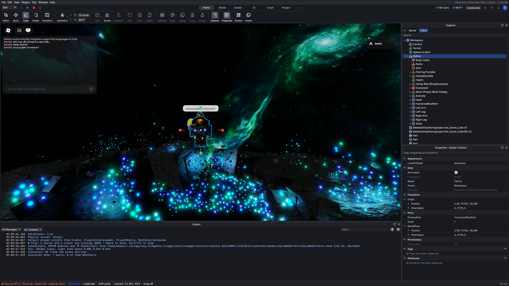

<p align="center">
  
</p>

<h1 align="center">rustudio</h1>

<p align="center">
  <a href="https://discord.gg/pdVZpADpWr"></a>
</p>

**A native Linux/Windows/macOS Roblox Studio, written in Rust.** Open, edit and save
Roblox places, press Play and run them with real Luau, physics, characters
and GUIs, without Wine.

Rustudio is very much a beta/prototype, I wouldn't call it a studio replacement
quite yet.




> This project is still early, so please please help!! Contributions are super welcome. Come hang out, ask for help or report bugs on the [Discord](https://discord.gg/pdVZpADpWr).

## Features

- **Editor:** Explorer, Properties, Output, script tabs, move/scale/rotate
  tools with drag duplication and selection rotation, pop-out panels, terrain
  brushes and threaded generation, undo/redo, and Studio's menus and shortcuts.
- **Files:** `.rbxl` / `.rbxlx` places and `.rbxm` / `.rbxmx` models, plus
  project folders (`*.project.json` with plain files as the source of truth,
  Rojo/Argon sync rules, `sourcemap.json`, and File > Save as Project
  Folder… to turn any place into one).
- **Roblox destinations:** Save to Roblox As and Publish As use the signed-in
  account. Browse personal, shared and group experiences in a searchable grid,
  then select an existing place or create a destination.
- **Plugins:** Roblox Studio plugins run in the editor: local plugins from a
  Plugins folder and plugins installed from the Creator Store, with
  toolbars, dock widgets, menus, drag and drop, and Plugins > Manage Plugins
  to install, update, turn off or remove them. Rojo and Argon connect.
- **Toolbox:** search the Creator Store, your Inventory, Recent and
  Creations, and insert models, meshes, images, audio and plugins (signed in).
- **Play / Run:** separate server and client, remotes, physics that follows
  Studio's solver (`RUSTUDIO_SOLVER=rapier` for the earlier rapier3d one),
  R15/R6 characters with climbing and held jump, saved play settings, shift
  lock, sounds, tweens, 2D and 3D GUIs.
- **Teleports in Play:** like Studio's play-testing teleports, a server's
  `TeleportService:TeleportAsync` to another place of the same experience
  starts Play on that place (the open place as it is in the editor, others
  at their latest saved version), with `TeleportData` in
  `Player:GetJoinData()` and `GetLocalPlayerTeleportData()`. Reserved
  servers work; deprecated teleport calls, client teleports, VIP servers and
  other experiences fail with Studio's messages.
- **Luau:** the real Luau VM, with most of the engine API that real games
  call (see [docs/ENGINE-GAPS.md](docs/ENGINE-GAPS.md) for what's missing).
- **Rendering:** wgpu, with lighting, shadows, sky, atmosphere and materials
  tuned against Studio, incremental local lights and truss geometry. Meshes,
  FBX import and terrain are supported.
- **Roblox account:** open your places, load assets and avatars, use
  DataStores, and join Team Create sessions.

## Install

**Download:** prebuilt Linux (x86_64), Windows (x64) and macOS (Apple Silicon
and Intel) builds are on the
[releases page](https://github.com/rippelz/rustudio/releases). On Linux, unpack and run
`./install.sh` inside the extracted folder; on Windows run `install.cmd` (or `rustudio.exe` for portable use).
On a Mac, move `rustudio.app` to
Applications and the first time right-click it > Open (it isn't notarized).
### Installing a prebuilt Windows download

Extract the Windows ZIP and double-click `install.cmd`. The install dialog lets
you choose a folder and whether to create a Start menu shortcut. It defaults to
`%LOCALAPPDATA%\Programs\rustudio` for your account. No administrator rights or Rust toolchain are needed.
The executable contains the icon, so Explorer and shortcuts can display it too.

Close rustudio before upgrading, then run `install.cmd` from the new download.
To remove the installation, run `uninstall.cmd` in the installed folder.
Uninstall preserves projects, settings, sign-in and downloaded Studio content.
The ZIP also supports portable use: run `rustudio.exe` directly without installing.

### Installing a prebuilt Linux download

Extract the Linux release archive, open a terminal in the extracted folder,
and run `./install.sh`. No Rust, Cargo, or source checkout is needed.
The installer puts the executable and API data in `~/.local/lib/rustudio`,
a command in `~/.local/bin`, and the launcher and icons in `~/.local/share`.
Launch **rustudio** from your applications menu; this works even if
`~/.local/bin` is absent from your session's PATH. The extracted folder can
then be removed.

To upgrade, extract the new archive and run its `./install.sh` again.
To uninstall, run `./install.sh --uninstall` from an extracted archive or
source checkout. Projects, settings, sign-in data, and downloaded content
are preserved. `--prefix /absolute/path` selects another installation root;
use the same prefix when upgrading or uninstalling. Custom prefixes may
need to be added to the desktop's data search path for menu discovery.

From a source checkout, `./install.sh` still builds with Cargo;
`./install.sh --no-build` installs `target/release/rustudio`.
Release maintainers can package a built executable with
`tools/linux/package.sh target/release/rustudio rustudio-linux.tar.gz`.

A downloaded copy checks for a newer release when it starts and can update
itself (each download is checked against the release's `SHA256SUMS`); set
`RUSTUDIO_NO_UPDATE_CHECK=1` to turn that off.

**Build from source:** you need a stable Rust toolchain (1.95 or newer) and a GPU with Vulkan (or OpenGL), or on
a Mac, macOS 11 or later (Metal).

```sh
git clone https://github.com/rippelz/rustudio
cd rustudio
cargo build --release
./target/release/rustudio --demo           # sample scene
./target/release/rustudio my_place.rbxl    # open a place
```

On Windows (MSVC toolchain), run `.\target\release\rustudio.exe` instead,
and see the Windows notes under [Platforms](#platforms).

On Linux you can install it for your user instead, so it shows up in your
app launcher and runs as `rustudio` from anywhere:

```sh
./install.sh                # build, then install into ~/.local
./install.sh --uninstall    # remove it again
```

The install keeps working if you move or delete the cloned folder.
`./install.sh --help` lists the other options (`--prefix`, `--no-build`).

On first launch rustudio downloads Roblox Studio's built-in content
(default characters, camera and control scripts, fonts, textures, sounds;
about 60 MB) from Roblox's own CDN into `~/.local/share/rustudio/studio`
(`%LOCALAPPDATA%\rustudio\studio` on Windows).
To get it ahead of time, or update it, run
`rustudio --install-studio-content`.

If you already have Studio installed (e.g. via
[Vinegar](https://vinegarhq.org)), you can point rustudio at that instead:

```sh
export RUSTUDIO_STUDIO_DIR=~/.var/app/org.vinegarhq.Vinegar/data/vinegar/versions/version-XXXX
```

On macOS, download `rustudio-…-macos-universal.zip` from
[Releases](https://github.com/rippelz/rustudio/releases) (Apple Silicon and
Intel in one), unzip it and move `rustudio.app` to Applications. It isn't
notarized by Apple, so the first time right-click it and choose **Open** (or
allow it in System Settings > Privacy & Security). To build the app
yourself instead: `tools/macos/bundle.sh` (`--universal` for both
architectures).

## Platforms

| Platform | Status |
|---|---|
| Linux x86_64 (Wayland or X11) | Supported |
| Linux ARM64 | Should build; untested |
| macOS 11+ (Apple Silicon and Intel) | Builds and runs (tested on Apple Silicon); see below |
| Windows x86_64 (MSVC) | Builds and runs (tested on Windows 11); see below |

CI checks and tests the workspace on Linux, Windows and macOS. CI also builds the
macOS app.

Windows is new, so a few things don't work there yet:

- Paths in this README are the Linux ones. On Windows, data and caches go
  in `%LOCALAPPDATA%\rustudio` (e.g. the Studio content download in
  `%LOCALAPPDATA%\rustudio\studio`) and settings in `%APPDATA%\rustudio`.
- Signing in is untested (the session cookie now goes through the
  Windows Credential Manager).
- Video playback is off (libvpx/libopus are loaded only on Linux), and a
  native crash doesn't write a crash report (panics still do).

On macOS:

- Data and settings go in `~/Library/Application Support/rustudio`, caches
  and crash reports in `~/Library/Caches/rustudio`.
- With Roblox Studio installed (`RobloxStudio.app`), rustudio uses its
  content and downloads nothing.
- Shortcuts are Studio for Mac's (⌘ for Ctrl, ⌥ for Alt; the delete key
  deletes), ⌘Q asks about unsaved changes, and places and models open from
  Finder. The session cookie goes in the login Keychain, and deleted project
  files in the Trash.
- Video playback needs `brew install libvpx opus`. Gamepads aren't read yet.

## Signing in

Everything above works signed out. To open your own places or load private
assets, sign in with your Roblox session: use the account button at the top
right and **Sign in with your browser** (rustudio shows a code that you
confirm on roblox.com, in whatever browser you're signed in to), paste the
`.ROBLOSECURITY` cookie there, or put it in `~/.config/rustudio/roblox-cookie`
(macOS: `~/Library/Application Support/rustudio/roblox-cookie`; `chmod 600`).
rustudio stores it in your login keyring (the Keychain on macOS). Details are in
[docs/AUTH.md](docs/AUTH.md).

## Docs

The editor lives in the root crate, with the shared engine and player code under `crates/`. Build the standalone player from source with `cargo build -p rustudio-player`.

- [docs/DEVELOPING.md](docs/DEVELOPING.md): workspace layout, command-line options, and tests.
- [docs/MECHANICS.md](docs/MECHANICS.md): every tuning number and where it
  comes from
- [docs/ENGINE-GAPS.md](docs/ENGINE-GAPS.md): engine API that's still missing
- [docs/TEAMCREATE.md](docs/TEAMCREATE.md): Team Create

## Not affiliated with Roblox

rustudio is an independent project. It is not made, endorsed or supported
by Roblox Corporation. "Roblox" and "Roblox Studio" are trademarks of Roblox
Corporation.

This repository doesn't redistribute Roblox Studio or its content. Studio's built-in
content (fonts, textures, avatar parts, `ReflectionMetadata.xml`) is
downloaded from Roblox's own CDN onto your machine on first launch and is
never redistributed here.

## License

MIT OR Apache-2.0, at your option. Vendored crates in `vendor/` keep their
own licences.
