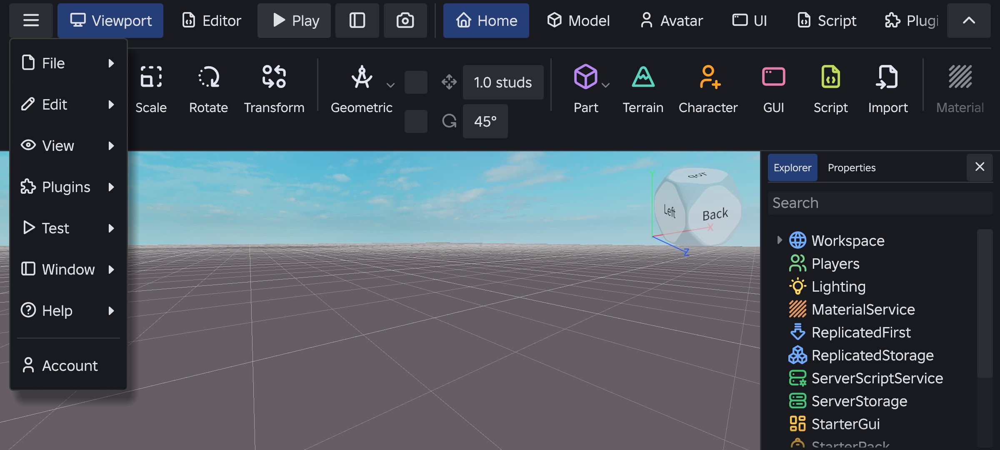
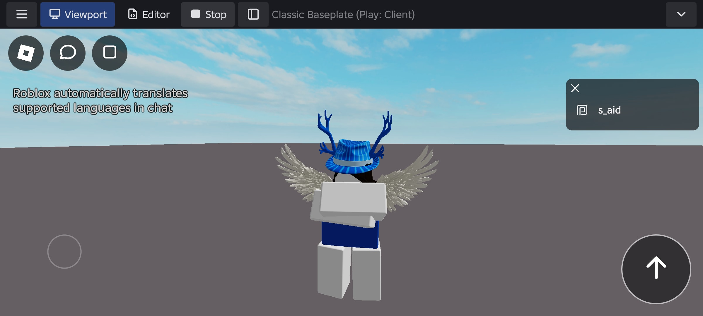

# RuStudioAPK

A native Android port of Rustudio, a native editor for Roblox places, written in Rust.

RuStudioAPK brings the [Rustudio](https://github.com/rippelz/rustudio) editing experience to Android, allowing users to work with Roblox place files directly on ARM64 devices running Android 8.0 or later.

[GitHub repository](https://github.com/saidrbx/RuStudioAPK) · [Releases](https://github.com/saidrbx/RuStudioAPK/releases) · [Android builds](https://github.com/saidrbx/RuStudioAPK/actions/workflows/android.yml)

> If you have any suggestions for UI improvements or other Studio-related features, feel free to share them so I can work on improving the project.

## Screenshots
This interface was designed to maximize screen space on mobile devices, keeping the layout compact and efficient.
| Editor | Play Mode |
|:---:|:---:|
|  |  |

## Build

Install JDK 17, Android SDK Platform 35, Build Tools 35.0.0, NDK 29.0.14206865, and Rust with rustup. Set `ANDROID_HOME` to your SDK directory or open the project in Android Studio.

```sh
rustup target add aarch64-linux-android
cargo install cargo-ndk --version 4.1.2 --locked
```

| Host | Command from the repository root |
| --- | --- |
| Linux | `./gradlew assembleDebug` |
| Windows | `.\gradlew.bat assembleDebug` |

The APK is written to `app/build/outputs/apk/debug/app-debug.apk`. See the [build guide](docs/android/BUILD.md) for setup details, GitHub Actions, and signing.

## Reporting Issues
When reporting a problem, please include:
- RuStudioAPK version.
- Android version.
- Device model.
- Steps to reproduce the issue.
- Screenshots or additional details, if applicable.

You can export diagnostic information directly from the editor:

**Menu → Help → Share Diagnostic Logs**

Review the exported logs before sharing them to ensure they do not contain sensitive information.

For additional instructions, see the [Usage Guide](docs/android/USAGE.md).

## Credits and license

The Android sources are based on Rustudio 0.5.1. See [upstream credits](rust/CREDITS.md), the [Android changelog](docs/android/CHANGELOG.md), and the [MIT](LICENSE-MIT) and [Apache 2.0](LICENSE-APACHE) licenses.